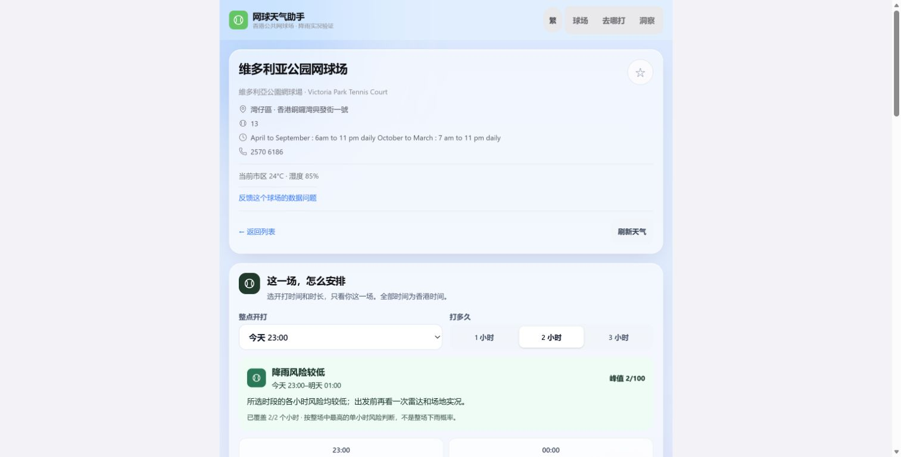

# GitHub 发布验收 · 2026-11-14

## 发布结果

已从公开GitHub仓库 `tendernessnick/weather_helper` 的 `master` 分支构建并发布，源码提交 `f6f73e2fc5e0c2e395f8303dfb68a3e0ab8cd0a3`。本目录为部署之后补充的记录，后续纯文档提交不代表又发布了应用。

- 现有服务：`weather-helper`，公网域名保持原地址。
- 云端版本：`weather-helper-004`，任务2641958，构建2612627622。
- 使用`DeployType=repository`，`RepoInfo.Source=github`，仓库`tendernessnick/weather_helper`，分支`master`；云端日志确认实际克隆Git仓库、执行Dockerfile、推送并运行新镜像。
- Dockerfile和构建上下文分别为`Dockerfile`和`.`，端口8000；0.25核/0.5G、最小/最大1实例沿用。
- 保留全部原有环境变量，回读值与发布前配置一致；密钥不进入本仓库。
- 先构建灰度版本，确认旧003承接100%、候选004为0；候选完成历史导入和接口验收后promote，回读确认004正常并承接100%，003为0。

访问：[网球天气助手](https://weather-helper-312215-10-1477032709.sh.run.tcloudbase.com/)。CloudBase默认测试域名可能显示平台访问提示，这与应用部署状态分别判断。

## 历史保留与验证

发布前补充一致性快照：2026-11-14 13:43:27 UTC。此前已验证的备份继续保留，新增快照也经过AES-GCM认证、ZIP CRC、数据库SHA256和完整性校验。

候选会自动采集新数据，因此恢复采用业务键事务合并，不覆盖正在使用的数据库文件，也不导入会与新数据碰撞的源自增ID。天气预报和观测冲突保留较晚版本，提前量快照保留更早的冻结版本；气候数据和进度标记整组处理。所有源业务键缺失数量均为0，完整性检查为`ok`。

为结束候选重复拉取已有十年气候数据，曾短暂保存并调整候选回填进度；等其当前请求和任务结束后恢复真实进度，再合并完整源气候组。验收确认临时进度值残留为0。旧003实例未作该调整。

合并后关键表：

| 表 | 行数 |
|---|---:|
| courts | 57 |
| forecast_snapshots | 47,196 |
| observations | 44,346 |
| nowcast_snapshots | 182,685 |
| forecast_leads | 181,571 |
| climatology | 16,416 |
| persistence | 684 |

新增候选记录也被保留；以上为合并验收时点，后续采集会改变计数。本次不宣称旧、新实例之间所有采集时刻的每份临时版本完全一致。

合并工具用真实131MB快照完成6项回归，覆盖新记录与自增ID碰撞、重复执行幂等、异常回滚、错误哈希拒绝、未知用户数据拒绝和气候分组。源库只读，候选合并一个事务完成；脚本、完整报告与原始备份保存在本机备份目录，不上传数据库或密钥。

## 线上验证

- 公网`/api/health`正常，57个球场、历史表计数达到已保全快照要求。
- 天气详情返回48小时、`data_status`新契约；`/api/best`覆盖57/57球场。
- 候选容器的`backend/app/main.py` SHA256与GitHub指定提交一致。
- 浏览器实测搜索“维多利亚”得到唯一结果；打开详情显示新版场次面板，2小时切换到3小时后覆盖更新为3/3。
- 历史评分显示近30天有效样本，表明页面使用已恢复历史。
- 验收时SWIRLS源超过新鲜度期限，页面如实显示雷达待更新；逐小时源仍新鲜。没有把过期临近预报当作无雨。

完整不含凭据的摘要见[verification.json](verification.json)。下图来自真实已上线页面：

## 自动发布与持久化边界

本次Git绑定自动建立了`push`发布Webhook。由于在线库目前仍为容器临时SQLite，已将**本次新建的CloudBase发布Webhook暂停**，防止之后普通提交触发重建而再次清空在线库。GitHub测试CI继续有效；以后仍可手动选择GitHub仓库发布。待持久化、自动恢复和数据迁移流程验证后再启用推送自动发布。

此次完成了代码上线和当前历史恢复，没有迁移PostgreSQL、挂载持久卷或实现自动定期备份。容器再次重建仍需独立恢复/迁移流程，不能把此次导入当作长期持久化已经完成。后续路线见[持久化研究](../storage-preservation-20261114/research.md)。

服务配置回退与数据库回退是两件事。后续回退或再次发布前，先保全当前增量，再核对目标版本的数据卷/恢复流程，不只回退镜像。
