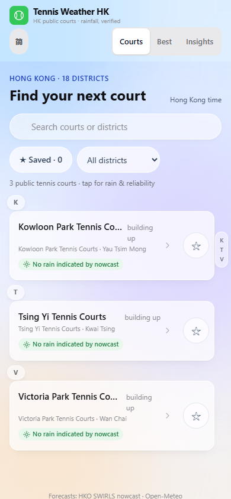
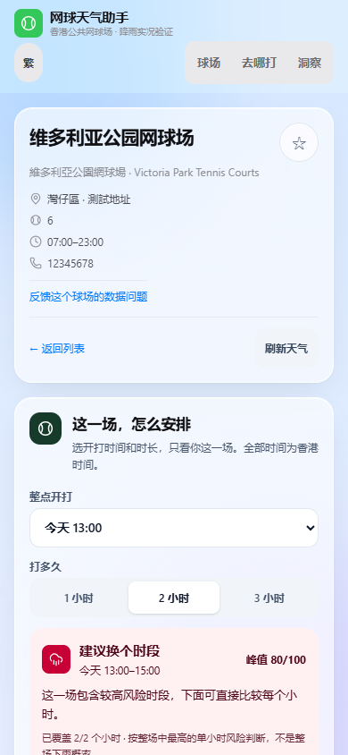

# 验收与回退 · 2026-11-14

## 完成内容

从「查看预报」补到「选择具体场次再决策」：详情支持开打时间与1/2/3小时、每小时风险与覆盖、峰值和来源时间；保留警告、上报、评分、打卡与订阅。收藏与地区筛选缩短回访路径；窄屏导航、键盘焦点、减少动态效果、错误重试和取消旧请求补齐。

数据层统一新鲜度：SWIRLS 25分钟、逐小时采集180分钟。前端随时间和网络状态重新判断，缺资料不再成为绿灯或绿色雨图。提醒新增未知态，香港时间贯穿显示和输入；修正中位数、Peirce、薄桶校准与BSS配对。融合值继续沿用既有加权法，明确为启发式风险指数，不宣称预测准确率因此提升。

## 已执行验证

| 项目 | 结果与边界 |
|---|---|
| 后端 | 完整 `pytest -q`：119通过；测试强制内存SQLite，无生产写入 |
| 前端 | 15项场次/日期边界单元测试通过；TypeScript、Vite、PWA生产构建通过 |
| 浏览器 | 10组回归通过，未捕获未处理页面异常；脚本见 `frontend/tests/browser-smoke.mjs`，结果见同目录 `browser-smoke.json` |
| 响应式 | 首页、球场列表、去哪打、球场详情 × 简/繁/英 × 320/390/768/1280，共48种组合，无页面横向溢出；截图人工检查 |
| 核心异常 | 缺失/旧/部分预报无低风险结论；警告、离线、雷达过期、排行榜长开失效；快速切换时旧响应不覆盖；接口失败后重试；缺数据雨图灰色 |
| 查找回访 | 收藏跨刷新保留；搜索、地区、收藏组合；搜索筛选无需新增网络请求 |
| 时区/订阅 | 香港与America/Phoenix浏览器默认提醒时间与提交值相同；无效时间不提交；推送不可用清楚提示页面内提醒限制 |
| 无障碍范围 | 英文首页/去哪打/详情的axe WCAG2 A/AA语义及名称规则通过，颜色对比规则排除；未声称完整WCAG合规或真机触摸验收 |
| 性能 | 基线入口414.98kB/gzip130.46kB；最终入口约315.76kB/gzip106.50kB，压缩入口减约18.4%。页面按需分包；PWA仍预缓存完整功能资源，不等同安装总量减少或线上测速 |
| 依赖 | 安全兼容更新后npm audit高风险5→0；生产依赖0项报告，开发构建链仍有2低/3中风险报告，原始前后JSON在本目录 |
| 上游/线上只读 | 开发前CloudBase `/api/health`正常、球场57个；官方SWIRLS CSV实际HTTP200、官方时间列和四步解析吻合。没有在线提交上报/打卡/订阅 |
| 静态检查 | `git diff --check`通过；`.env`、SQLite、本机日志及测试临时产物不入库 |

浏览器全部使用确定性API fixture；两张截图为本地测试展示，含「测试地址」，不是线上天气记录。

## 自动化与运行边界

新增 `.github/workflows/ci.yml`：每次master推送/PR执行后端、前端与Chromium浏览器回归，上传截图/测试结果。最终远端运行结果在GitHub Actions查看。

CloudBase单实例常驻和SQLite持久卷仍按README配置。本轮未执行CloudBase部署或存储改动，GitHub推送不能证明线上已更新。当前机器Docker引擎未运行，未执行镜像构建；前后端生产构建与本地浏览器验证已完成。现有SQLite无需新增schema迁移。

## 备份与回退

- 原始提交：`4a845550c7fb07a76e9652c6a14e85fcfedb6032`。
- 远端备份标签：`weather-helper-before-optimization-20261114`。
- 完整历史bundle：`F:/AICoding/_backups/weather-helper-before-optimization-20261114/repository.bundle`，已verify；同目录保存原始dirty patch、README/main/scheduler副本和状态。
- 备份标签对应原始已提交版本，开工前的CloudBase迁移和调度锁尚未提交，所以另存patch后在本轮保留、验证并一并提交。
- 代码需回退时对本轮优化提交执行 `git revert <commit>`，生成新回退提交后再发布；不重写共享分支历史。需要恢复原始未提交环境时在独立目录取出备份bundle再应用working-tree.patch。
- 标签/bundle只恢复代码。真实数据库持久化和备份仍需独立配置；本轮没有删改真实数据。
